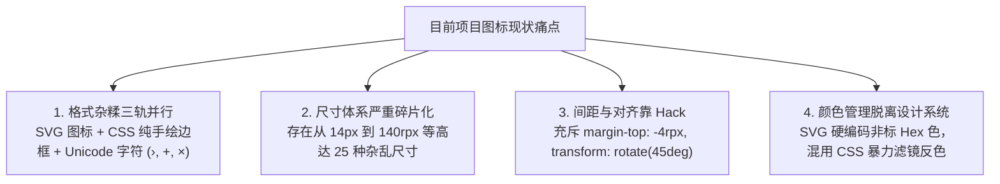

# OnlyNail (NailBook) Airbnb 图标系统设计标准规范 (Icon System Specification)

> **设计基准**：Google Material Symbols (Outlined, Weight 400) 为全站单一事实源 (Single Source of Truth)，融合 Airbnb DLS 亲和美学  
> **适用范围**：微信小程序 `client-wxapp/` 全局组件与所有 79 个页面  
> **核心原则**：统一 24×24 基准网格、统一 Weight 400 (2px) 线重、统一 Outlined(默认)/Filled(选中) 双态语义、统一触控防线 (≥44px)、统一调色盘映射  

---

## 一、 现状诊断与调研分析 (Audit & Research)

在本次规范制定前，对项目全量代码进行了深入的代码与资产摸排，发现存在以下四大核心问题：



### 1.1 格式碎片统计
- **SVG 文件**：`static/icons/` 存有 88 个 SVG，但其基准网格不一（82 个 `0 0 24 24`，4 个 `0 0 48 48`，2 个 `0 0 80 80`），描边粗细从 `1.5` 到 `4.0` 各不相同；
- **CSS 伪元素手绘图形**：在 `client/home`, `chat-detail`, `orders` 等页面大量存在使用 `border` + `border-radius` + `transform: rotate` 手动画出的时钟、图钉、日历、箭头、放大镜；
- **Unicode 字符伪装图标**：代码中大量使用纯文本字符作为图标，包括 `›` (126 处)、`‹` (5 处)、`+` (110 处)、`×/✕` (50 处)、`✓` (28 处)。不同移动操作系统（iOS / Android / 鸿蒙）下文本字体对齐基线不同，导致图标严重高低不齐和字形失真。

### 1.2 尺寸碎片统计
WXSS 中分散定义了：`20rpx`, `24rpx`, `26rpx`, `28rpx`, `30rpx`, `32rpx`, `34rpx`, `36rpx`, `38rpx`, `40rpx`, `44rpx`, `48rpx`, `52rpx`, `56rpx`, `64rpx`, `72rpx`, `80rpx`, `88rpx`, `96rpx`, `14px` 等。
缺少系统化阶梯，同一个右箭头 `›` 在不同页面从 `14rpx` 到 `36rpx` 随处定义。

---

## 二、 Airbnb 风格图标设计哲学与设计语言 (Design DNA)

Airbnb 图标系统以**克制、亲和、清晰、精确**著称。结合本项目受众（年轻爱美女性客户）与业务特征（专业手艺人美甲师），确立以下设计 DNA：

1. **几何基准网格 (Base 24 Grid)**：
   - 所有功能图标统一在 **24×24 像素网格** 内绘制；
   - 留设 **2px 安全边距** (Live Area 为 20×20)，确保并排陈列时视觉分量（Visual Mass）绝对平衡。
2. **圆润柔和的线条语调 (Gentle & Human Stroke)**：
   - 统一描边粗细：基准为 **1.8px ~ 2.0px**；
   - 端点与拐角必须为圆角：`stroke-linecap="round"` 与 `stroke-linejoin="round"`，杜绝锐利机械直角。
3. **线性与面性双态系统 (Outlined & Filled States)**：
   - **默认未选中/常态**：保持优雅的线性轮廓（Outlined，`fill="none"`）；
   - **激活/选中态**：切换为饱满的实心面性（Filled，填充对应语义色，如爱心 `#B42332`、星标 `#D4A017`、导航选中 `#245EA8`）。
4. **告别字符与 CSS 手绘 (Pure Vector Architecture)**：
   - 彻底废止 `›`, `+`, `×`, `✓` 等 Unicode 字符图标；
   - 彻底废除 CSS 拼接伪元素图标，全量采用标准化 SVG 资产。

---

## 三、 标准尺寸分阶体系 (Icon Scale System)

在 `styles/tokens.wxss` 中正式确立 6 级图标标准尺寸，并禁止页面任意手写非标尺寸：

| 尺寸等级 | 令牌变量 (Token) | 尺寸 (rpx / px) | 对应字阶 | 典型应用场景 |
| :--- | :--- | :--- | :--- | :--- |
| **Micro (极小)** | `--icon-xs` | `20rpx` (10px) | `--font-xs` | 状态徽标小点、紧凑角标、行内微小标记 |
| **Small (小号)** | `--icon-sm` | `28rpx` (14px) | `--font-sm` | 紧随文本的伴随图标（时间时钟、地址图钉、行尾箭头 `arrow-right`） |
| **Regular (标准)** | `--icon-md` | `36rpx` (18px) | `--font-md` | 标准列表行前缀、表单字段图标、行动按钮内操作图标 |
| **Large (中大)** | `--icon-lg` | `44rpx` (22px) | `--font-lg` | 底部 TabBar 图标、导航栏核心操作图标 |
| **Extra Large (大号)** | `--icon-xl` | `56rpx` (28px) | `--font-2xl` | 弹窗动作引导大图标、服务分类圆卡入口 |
| **Display (插标)** | `--icon-display` | `88rpx` (44px) | Display | 空状态兜底卡片大插图、预约成功结果反馈主图标 |

### 独立图标触控保护线 (Hitbox)
- **`--icon-touch: 44px (88rpx)`**：凡是具有点击交互的独立图标（如导航栏返回、关闭按钮、相册删除、收藏按钮），必须具备最小 44px × 44px 的透明触控外框，内部图标水平垂直居中，满足 iOS/Android 无障碍触控底线。

---

## 四、 间距与排版规则 (Spacing & Inline Rhythm)

1. **内联伴随排版 (Inline with Text)**：
   - 图标与伴随文字水平间距统一为：
     - 紧凑标签/小按钮：`gap: var(--space-xs)` (`8rpx` / 4px)；
     - 常规行/大按钮：`gap: 12rpx` (6px) 或 `var(--space-sm)` (`16rpx` / 8px)；
   - 严禁在单个图标上写死 `margin-top: -4rpx` 等偏移补丁，父容器一律采用 `display: inline-flex; align-items: center;` 自然居中。
2. **列表行尾指引图标 (Disclosure Indicator)**：
   - 统一采用 `<image class="icon-disclosure" src="/static/icons/arrow-right.svg"/>`；
   - 尺寸锁定为 `--icon-sm` (`28rpx`)，颜色为 `--nb-muted` (`#6E6E73`)。

---

## 五、 色彩配置与语义映射 (Color Token Mapping)

因为微信小程序 `<image src="*.svg"/>` 独立运行于图像沙箱，SVG 颜色必须严格与项目 `--nb-*` 调色盘精准映射：

| 图标语义角色 | 颜色标准色值 | 对应设计令牌 | 适用图标范例 |
| :--- | :--- | :--- | :--- |
| **默认弱化中性** | `#6E6E73` | `--nb-muted` | 占位搜索镜、展开箭头、未选点赞/收藏、次要时间戳 |
| **深色正文伴随** | `#48484D` | `--nb-secondary` | 表单输入前缀、列表主图标、已读消息标记 |
| **石墨黑主操作** | `#1D1D1F` | `--nb-ink` / `--nb-action` | 纯白卡片主图标、高反差导航键、选中状态指示 |
| **深色背景反白** | `#FFFFFF` | `--nb-inverse` | 黑色按钮内操作图标（`phone-white.svg`、`navigation-white.svg`） |
| **文字链接激活** | `#245EA8` | `--nb-text-link` | 底部激活 Tab、高亮指示（`tab-*-active.svg`、`phone-active.svg`） |
| **业务-成功有效** | `#287A4B` | `--nb-success` | 选择完成勾选（`check-circle.svg`）、营业中圆点 |
| **业务-警告金额** | `#B42332` | `--nb-money` / `--nb-danger` | 激活点赞心形（`social-heart-active.svg`）、错误删除 |
| **业务-尊享收藏** | `#D4A017` | `--nb-favorite` | 激活星标（`social-star-active.svg`）、会员皇冠（`crown.svg`） |

---

## 六、 统一图标样式工具库 (Icons Utility Classes)

在 `styles/tokens.wxss` 与 `styles/icons.wxss` 中输出开箱即用的公共工具类：

```css
/* 标准图标基类 */
.nb-icon {
  display: inline-block;
  vertical-align: middle;
  flex-shrink: 0;
}

/* 阶梯尺寸工具类 */
.nb-icon-xs { width: var(--icon-xs); height: var(--icon-xs); }
.nb-icon-sm { width: var(--icon-sm); height: var(--icon-sm); }
.nb-icon-md { width: var(--icon-md); height: var(--icon-md); }
.nb-icon-lg { width: var(--icon-lg); height: var(--icon-lg); }
.nb-icon-xl { width: var(--icon-xl); height: var(--icon-xl); }
.nb-icon-display { width: var(--icon-display); height: var(--icon-display); }

/* 独立可触控图标按钮包裹器 */
.nb-icon-button {
  min-width: var(--icon-touch);
  min-height: var(--icon-touch);
  display: inline-flex;
  align-items: center;
  justify-content: center;
  box-sizing: border-box;
  background: transparent;
  border: 0;
  padding: 0;
}
.nb-icon-button:active {
  opacity: 0.7;
}
```

---

## 七、 Google Material Symbols (Outlined, Weight 400) 落地执行字典

### 7.1 单一事实源规范 (Single Source of Truth)
1. **网格尺寸统一**：全量 94 个功能 UI 图标均以 `viewBox="0 0 24 24"` 为绝对网格基准（排除第三方品牌标 `wechat.svg` 与默认头像插图）。
2. **线重标准统一**：严格锁定 Google Material Symbols **Weight 400** 规范（24px 网格下标准描边宽度为 `2px`），拐角和端点使用圆角 `stroke-linecap="round"` 与 `stroke-linejoin="round"`。
3. **消除沙箱失效隐患**：彻底清除 SVG 内部 `currentColor`，统一使用设计系统明确令牌色（默认态 `#6E6E73`、高反差 `#1D1D1F`、反白 `#FFFFFF`）。
4. **同构双态对应 (Outlined vs Filled)**：每一个具有状态交互的图标，其未选中态（Outlined，`fill="none"`）与选中态（Filled，`fill="<semantic>"`）必须共享完全重合的几何骨骼，切换时零抖动、零变形。

### 7.2 核心图标映射字典 (Core Icon Mapping Dictionary)

| 资产文件 (`static/icons/`) | Google Material Symbol 源 | 默认态 (Outlined) 规范 | 选中/激活态 (Filled) 规范 | 业务场景 |
| :--- | :--- | :--- | :--- | :--- |
| `nav-back.svg` / `arrow-left.svg` | `chevron_left` / `arrow_back` | 24×24, 2px stroke, #6E6E73 | - | 导航栏返回、历史回退 |
| `arrow-right.svg` | `chevron_right` | 24×24, 2px stroke, #6E6E73 | - | 列表项展开、进入下一级 |
| `search.svg` | `search` | 24×24, 2px stroke, #6E6E73 | - | 发现页/消息搜索栏前缀、空状态 |
| `calendar.svg` / `booking-calendar.svg` | `calendar_today` / `event` | 24×24, 2px stroke, #6E6E73 | `tab-calendar-active.svg` (Filled #245EA8) | 预约日期选择、日历工作台 |
| `clock.svg` / `clock-light.svg` | `schedule` / `access_time` | 24×24, 2px stroke, #6E6E73 | - | 预约服务时长、到期时间指示 |
| `social-heart.svg` | `favorite` | 24×24, 2px stroke, #6E6E73 | `social-heart-active.svg` (Filled #B42332) | 作品点赞、美甲师作品喜欢 |
| `social-star.svg` | `star` | 24×24, 2px stroke, #6E6E73 | `social-star-active.svg` (Filled #D4A017) | 作品收藏、客户星标 |
| `share.svg` | `share` | 24×24, 2px stroke, #6E6E73 | - | 作品分享、邀约海报转发 |
| `edit.svg` / `profile-edit.svg` | `edit` / `edit_note` | 24×24, 2px stroke, #6E6E73 | - | 作品编辑、个人资料修改、写评论 |
| `delete.svg` | `delete` | 24×24, 2px stroke, #6E6E73 | - | 删除作品、移除照片 |
| `more-horizontal.svg` | `more_horiz` | 24×24, 3点对齐, #6E6E73 | - | 标题栏三点管理菜单 |
| `tab-home.svg` | `home` | 24×24, 2px stroke, #6E6E73 | `tab-home-active.svg` (Filled #245EA8) | 首页 Tab 导航 |
| `tab-customers.svg` | `group` | 24×24, 2px stroke, #6E6E73 | `tab-customers-active.svg` (Filled #245EA8) | 客户档案管理 Tab |
| `tab-chat.svg` | `chat` | 24×24, 2px stroke, #6E6E73 | `tab-chat-active.svg` (Filled #245EA8) | 消息/沟通 Tab |
| `tab-profile.svg` | `person` | 24×24, 2px stroke, #6E6E73 | `tab-profile-active.svg` (Filled #245EA8) | 我的个人中心 Tab |
| `tab-works.svg` | `grid_view` | 24×24, 2px stroke, #6E6E73 | `tab-works-active.svg` (Filled #245EA8) | 美甲师作品库 Tab |
| `check.svg` / `check-circle.svg` | `check` / `check_circle` | 24×24, 2px stroke | `check-circle.svg` (Filled #287A4B) | 选择完成勾选、成功提示 |
| `close.svg` / `picker-close.svg` | `close` | 24×24, 2px stroke, #6E6E73 | - | 弹窗关闭、清除筛选 |
| `plus.svg` / `picker-plus.svg` | `add` | 24×24, 2px stroke, #6E6E73 | - | 添加作品、步进器增加 |
| `picker-minus.svg` | `remove` | 24×24, 2px stroke, #6E6E73 | - | 步进器减少 |

---

## 八、 自动化发布门禁保障 (Continuous Governance)

在 `client-wxapp/scripts/test-icon-system.js` 中集成自动拦截守卫：
- 扫描 `static/icons/*.svg` 全量文件；
- 校验 viewBox 必须为 `0 0 24 24`（白名单外）；
- 校验不得包含 `currentColor`；
- 校验状态图标未选中/选中几何一致性；
- 门禁脚本接入 `release-gate.js`，任何新增非标图标将直接阻断构建与发布。

