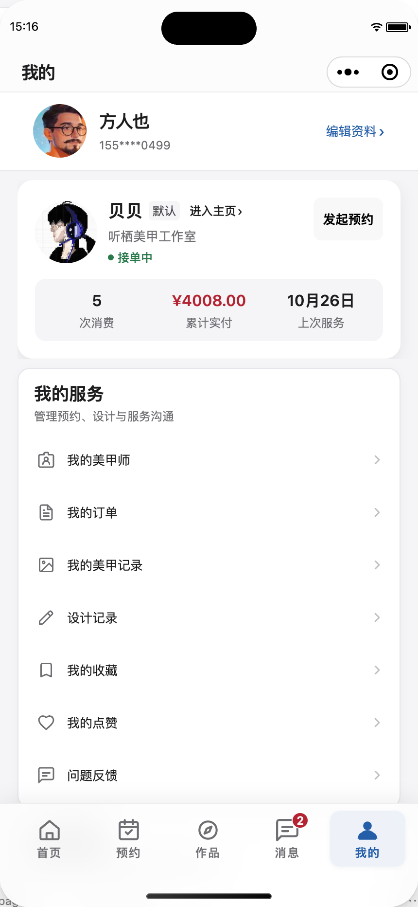
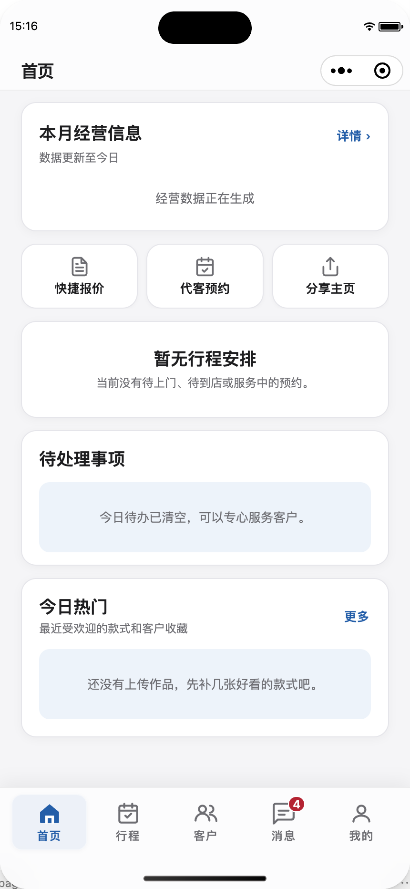
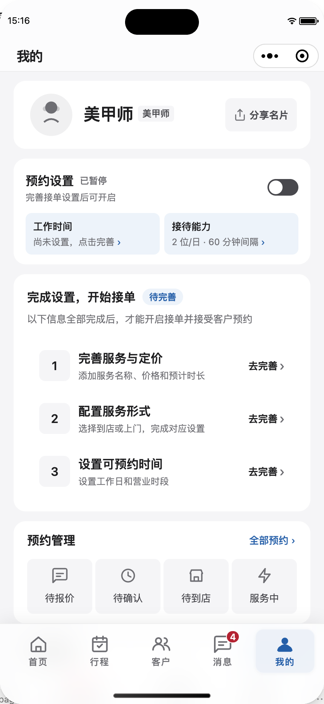

# Airbnb 上线前摸排证据

2026-10-30，新采集于微信开发者工具，430 × 932 逻辑像素。

1. 01-client-home：客户首页，真实已登录只读浏览。
2. 02-client-works：全部作品二级页，真实已登录只读浏览；不显示底部 Tab 属于合理的层级行为。
3. 03-client-profile：客户我的，真实已登录只读浏览；手机号为页面原有脱敏展示。
4. 04-technician-home：美甲师首页，本地模拟空数据，用于检查布局，不用于判断真实待办数量。
5. 05-technician-profile：美甲师我的，本地模拟未完善资料状态。
6. 07-client-discover：客户作品主 Tab，真实已登录只读浏览。

服务管理页的本次模拟数据截图未得到可接受的内容，排除于正式视觉证据，需另行复核空态/加载态。未将其认定为生产缺陷。

测试未点击保存、提交、删除或发布；临时角色和请求接口已恢复。截图只存本地，未上传第三方。route-inventory.json 为 app.json 中 82 个注册路由的组件与样式结构清单，不代表 82 页均已完成视觉验收。

## 本轮已检查截图

