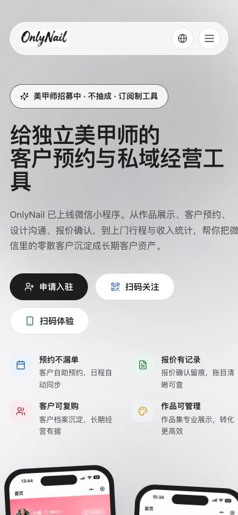
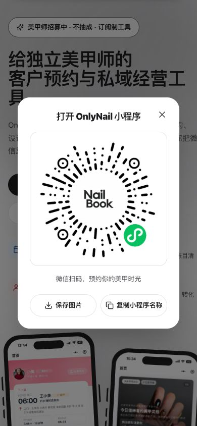
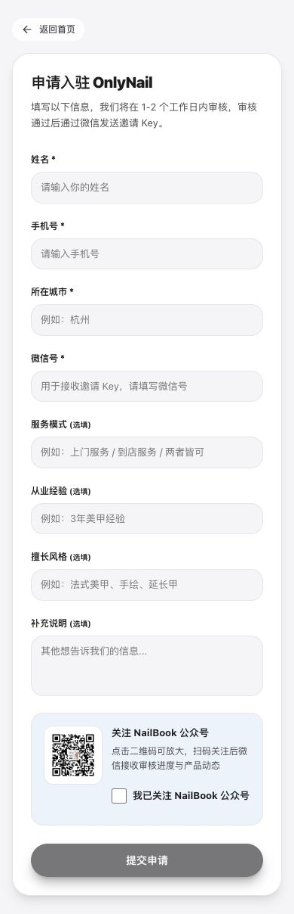
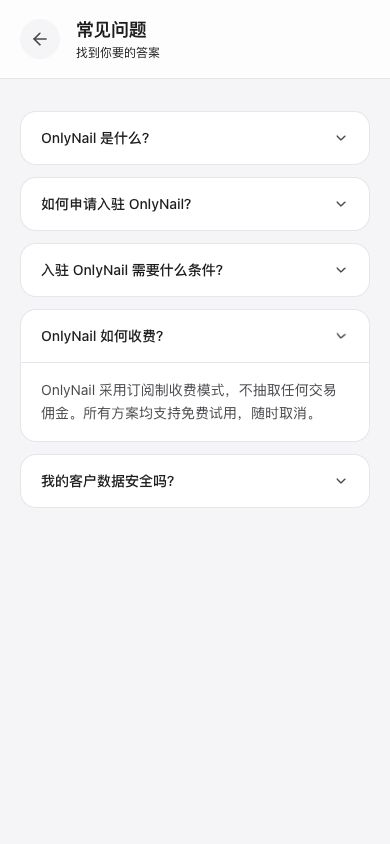
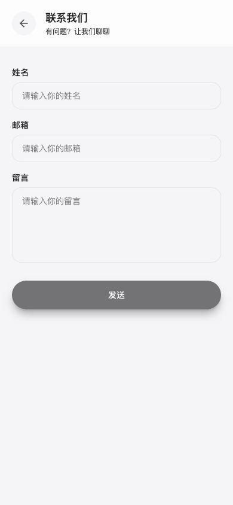
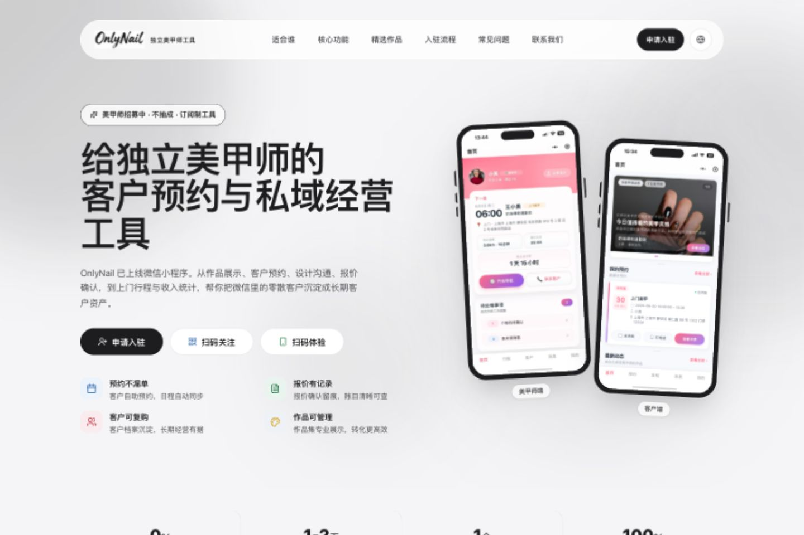

# 官网页面证据与审查记录

日期：2026-10-14。截图均来自本次本地 `website/` 的实际渲染，保存后重新读取并检查。首个视口切换时产生的未稳定截图已被重新捕获的稳定截图覆盖，不用作结论依据。

## 1. 首页识别产品——有基础，手机表达需修复

390×844：能看见招募、产品定位和申请按钮。标题末尾单字断行；正文与右侧优势区出现截切；三种行动占两排；普通卖点彩色装饰、底部旧粉色界面与当前产品规范不一致。

截图支持当前视口的观察，不等于所有手机都有同样问题。DOM 测量视口与文档宽度均为 390，不能仅靠无横向滚动判断内容没有被内部容器裁剪。未进行真实设备性能测试。

对应报告：F05、F06、F15。

## 2. 扫码体验——弹层可打开，角色与手机承接待验证

点击“扫码体验”打开小程序码，有关闭、保存图片、复制名称。提示“预约你的美甲时光”是客户端措辞；码中央 NailBook 与标题 OnlyNail 需要解释。当前桌面内置浏览器无法证明微信真机能识别并抵达正确流程；未复制名称、未下载图片、未扫描或登录。

截图能证明弹层布局，焦点圈定/恢复问题来自源码检查，不是屏幕阅读器实测。

对应报告：F07、F14。

## 3. 申请入驻——可访问，提交链路未执行

点击首页申请进入表单。姓名、手机号、城市、微信号必填，四项选填继续占据页面，公众号确认位于提交前。当前无填写，提交按钮禁用。截图与 schema 共同证明强制关注条件；服务模式契约问题来自前后端代码比对。

没有填写或提交真实/虚构个人信息：本地 Vite 代理连接生产 API，避免给生产制造申请记录。因此成功、失败、重复申请和后台审批状态只做代码审查，不称已端到端验证。

对应报告：F01、F02、F08、F12、F13。

## 4. FAQ 收费说明——可展开，但政策不完整

访问现有 `/faq`，展开“OnlyNail 如何收费”。能看到订阅、不抽成、免费试用、随时取消，未见价格、试用条件或当前邀请阶段说明。FAQ 交互基本成立；返回按钮缺少可访问名称、点击区域 40px 的判断有源码依据。

对应报告：F04、F14。

## 5. 联系渠道——页面可见，实际提交实现不成立

访问现有 `/contact`，看到姓名、邮箱、留言和发送按钮。源码 `onSubmit` 使用 setTimeout 模拟成功，无服务调用；未填写并触发此假成功，以代码作为功能判断证据。

对应报告：F03。

## 6. 桌面首页对照——布局成立，素材需要更新

1440×960：导航、招募 CTA 与两张手机预览可见。桌面信息较完整，但标题仍偏长，手机预览展示旧粉色界面；无法作为新版小程序实际界面证明。结束后已恢复临时视口设置。

对应报告：F06、F15。

## 7. 额外代码证据与验证

- 首页底部号召申请但实际仅有两个扫码按钮：`website/src/pages/HomePage.tsx`。
- 作品列表本轮页面没有卡片，前端 catch 只设置 loaded，无失败提示：`FeaturedWorksSection.tsx`；不据此判定生产 API 故障。
- 申请中文自由文本与 home/shop/both 不匹配：`ArtistApplicationPage.tsx` 与 `artist-applications.service.ts`。
- 审批只创建账号，单独的激活 Key 生成方法在 `technicians.service.ts`；管理后台申请审批未使用返回的账号继续交付。
- 经营数据已有全量记录导出：`business-data/index.js` 调用 `revenues.exportFull`；后端导出客户、订单、作品和收入，不能据此宣称完整所有权或媒体原件迁移。
- 现有官网测试：1 文件 4 测试通过（Skeleton）；类型检查通过。未运行生产写操作，未做官网生产构建、微信真机、完整无障碍或性能审计。

证据文件使用相对图片路径便于随目录保存；完整结论见 [REPORT.md](REPORT.md)，任务见 [DEVELOPMENT-PLAN.md](DEVELOPMENT-PLAN.md)。
